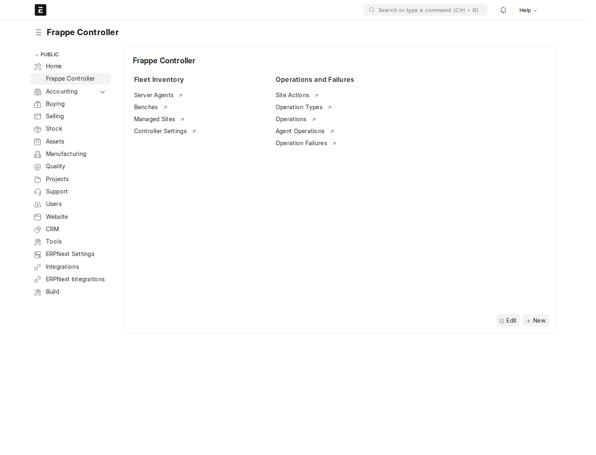
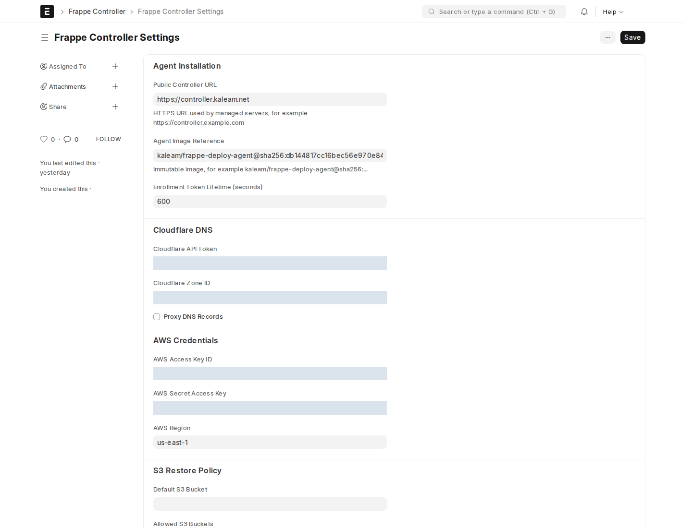
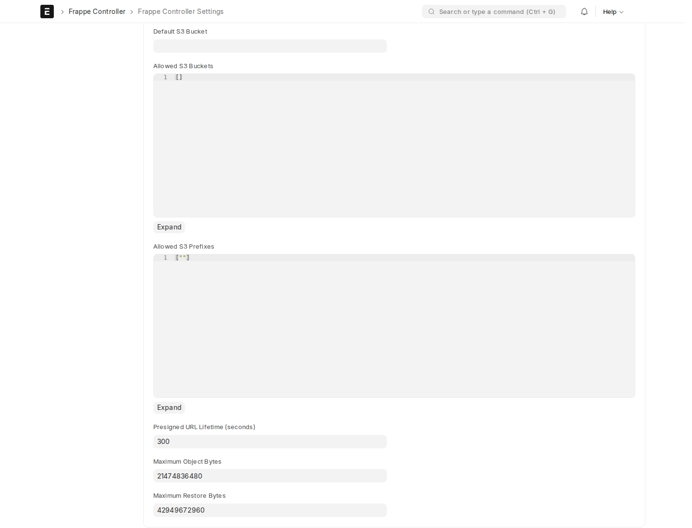
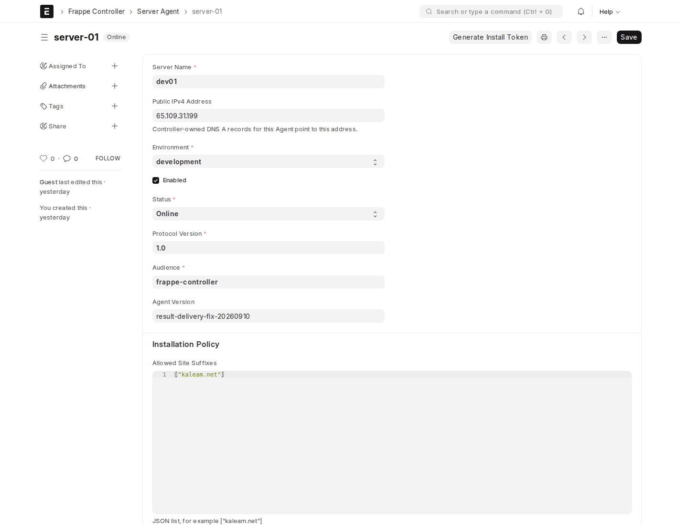
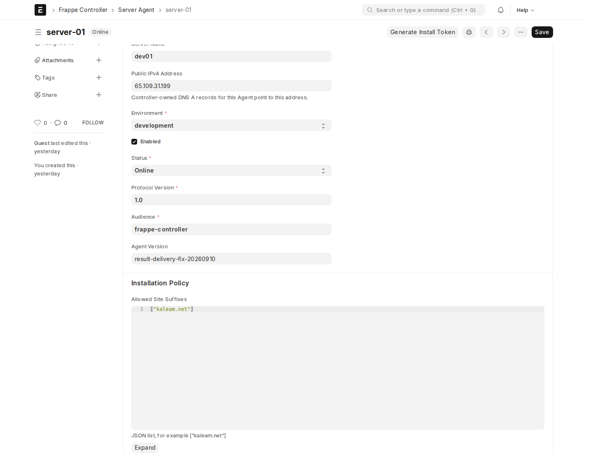
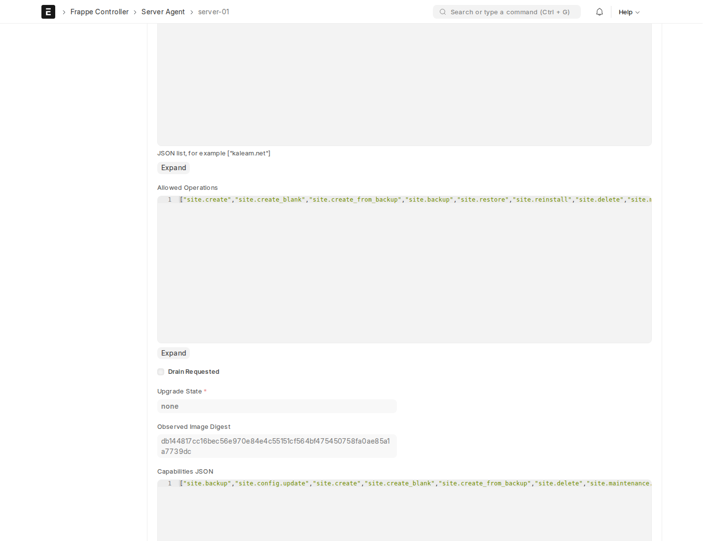
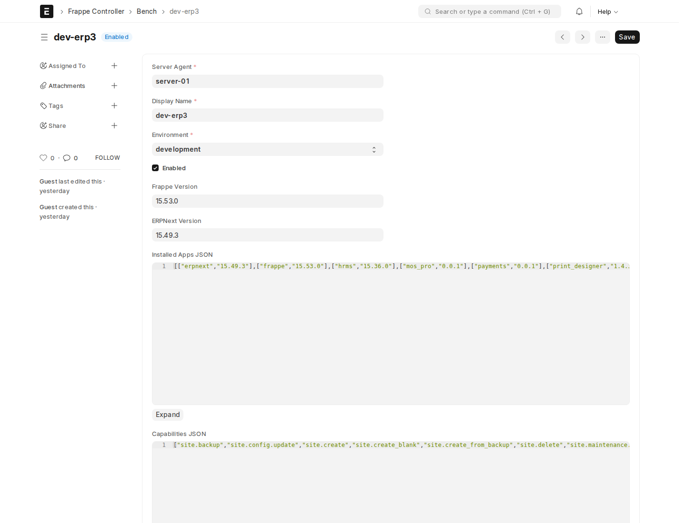
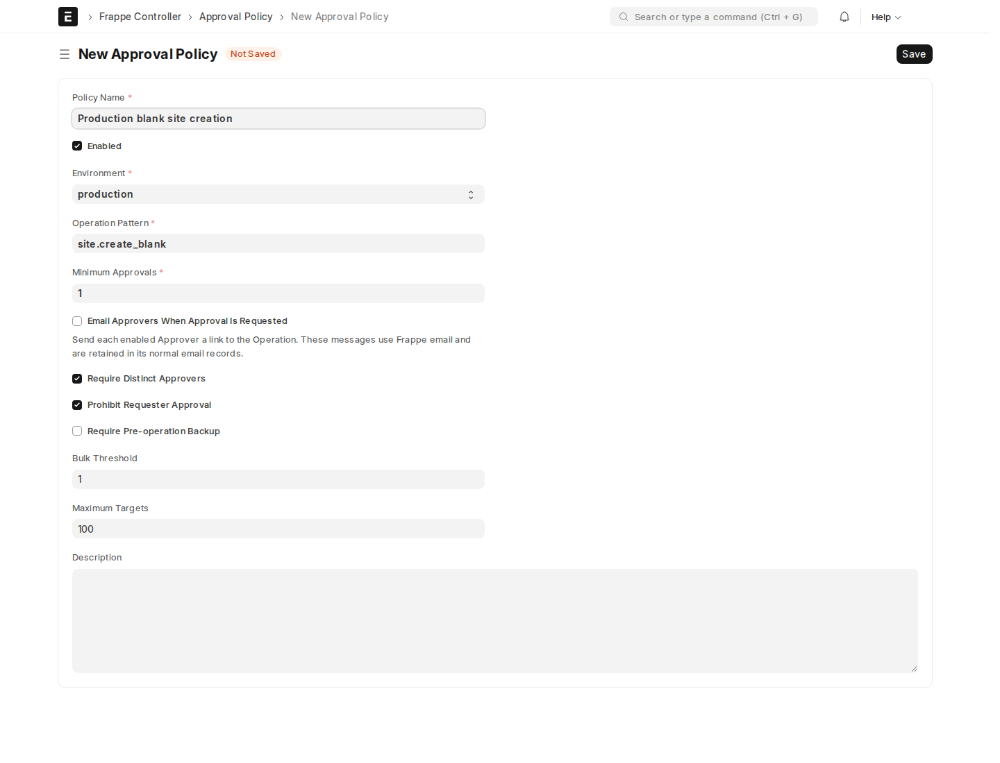
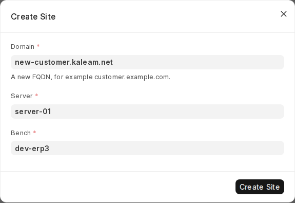
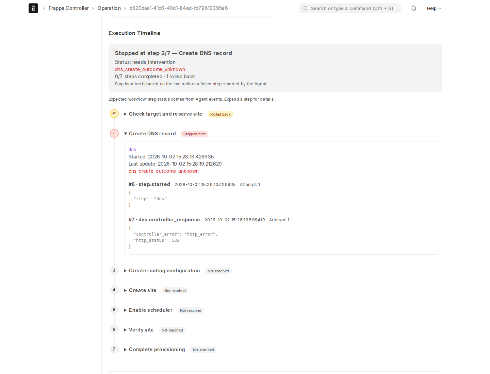

# Frappe Controller configuration guide

This guide explains how to configure `controller.kaleam.net` to manage Frappe servers and create customer sites with **Frappe, ERPNext, and mos_pro**. It is written for the Controller administrator and the server administrator. Finish the configuration and readiness checks before creating a real customer site.

Prepared on **3 October 2026**, using Controller source revision `4cb44a0` and screenshots of the deployed site. Screenshots show real screens; password fields are concealed. The Approval Policy example and Create Site dialog were filled only in the browser and were **not submitted**. No configuration was saved, enrollment token generated, password consumed, or site/job created to prepare this guide.

> **Deployment warning:** At capture time, the deployed Bench form did not have **Provisioning Required Apps**, and the Customer dialog did not have **Check Readiness**. These features exist in the pushed repository but require deployment. Screenshots document the current interface, not proof that the new workflow is running. Follow the upgrade section before testing the new readiness workflow.

## Contents

1. [Understand the components](#understand-the-components)
2. [Prepare access and prerequisites](#prepare-access-and-prerequisites)
3. [Enable the required features](#enable-the-required-features)
4. [Configure Controller Settings](#configure-controller-settings)
5. [Configure DNS](#configure-dns)
6. [Configure optional backup and restore storage](#configure-optional-backup-and-restore-storage)
7. [Configure the Server Agent](#configure-the-server-agent)
8. [Enroll a new managed server](#enroll-a-new-managed-server)
9. [Configure the Bench and required apps](#configure-the-bench-and-required-apps)
10. [Configure approvals](#configure-approvals)
11. [Deploy the coordinated upgrade](#deploy-the-coordinated-upgrade)
12. [Create a Customer site](#create-a-customer-site)
13. [Read operation progress and handle failures](#read-operation-progress-and-handle-failures)
14. [Complete the acceptance checklist](#complete-the-acceptance-checklist)
15. [Troubleshoot configuration](#troubleshoot-configuration)
16. [Maintain and recover the Controller](#maintain-and-recover-the-controller)

## Understand the components

The Controller decides what is permitted and records operations. The Agent polls the Controller and runs the workflow. The root-owned Host Helper executes approved, fixed Bench commands on the managed server.

| Component | Configure here | Responsibility |
| --- | --- | --- |
| Controller | Frappe Desk plus repository-managed deployment files | Users, provider credentials, server records, approvals, operation history |
| Agent | Managed-server Compose and protected policy files | Signed requests, inventory, durable jobs, retries, result delivery |
| Host Helper | Root-owned systemd service and policy | Fixed Docker/Bench operations and access to database root credentials |
| Target Bench | Existing managed Frappe stack | Available application code, MariaDB, Redis, frontend and sites |
| Traefik | Managed-server proxy configuration | HTTPS hostname routing to the correct Bench frontend |

The Controller site runs `frappe`, `erpnext`, and `frappe_controller`. New customer sites use the configured profile `frappe`, `erpnext`, `mos_pro`; **do not install `frappe_controller` on customer sites** as part of that profile.

Keep fixes and configuration changes in the repository first. Recreate services from reviewed source/images. Editing a running container does not make a durable deployment.

## Prepare access and prerequisites

1. Open [Controller Desk](https://controller.kaleam.net/app) over working HTTPS.
2. Sign in with an administrator account. Use ordinary named accounts for daily work rather than sharing Administrator credentials.
3. In **User**, assign roles appropriate to the task:

   | Role | Intended use |
   | --- | --- |
   | Controller Admin | Controller Settings, Agent enrollment, Approval Policies, administration |
   | Operator | Author operations and create Customer sites, subject to policy |
   | Approver | Approve another requester's operations |
   | Auditor | Read Controller records and audit history |

4. Ensure the operator also has the required ERPNext **Customer read/write permissions**. A Controller role alone does not replace Customer document permissions.
5. Prepare a Linux managed server with systemd, Docker Compose, an existing Frappe Bench, and administrative access. Host Helper installation needs root privileges and Python with its venv/pip support.
6. Make sure the target Bench image contains `frappe`, `erpnext`, and `mos_pro`. The provisioning workflow installs available apps on a site; it does not download missing app repositories into the Bench.
7. Have access to the Cloudflare zone, the server's public IPv4 address, Traefik configuration, and the correct Bench database root password. Keep passwords out of Git and documentation.
8. Ensure the Controller can reach the managed server's public TCP port 443, and the Agent can reach the Controller by HTTPS. Keep server time synchronized for signed requests.

Open **Frappe Controller** from Desk search to find its lists and actions. If links are missing, inspect feature flags, roles, migrations and assets before adding manual UI customizations.



*Figure 1. Current workspace. Feature visibility depends on deployment-owned flags and user roles.*

## Enable the required features

Feature flags are **not a Desk settings form**. They are a root-owned deployment policy. For the repository's Compose deployment, edit `deploy/controller-feature-flags.json` in `/home/mos/frappe-deploy-agent` and redeploy the configuration service through the normal deployment process.

For Customer site creation on the development target, the policy is:

```json
{
  "schema_version": 1,
  "master_enabled": true,
  "features": {
    "inventory": ["development"],
    "backup_and_verify": [],
    "routine_operations": [],
    "restore_and_reinstall": ["development"],
    "quarantine_delete": [],
    "data_update_preview": [],
    "data_update_apply": [],
    "bulk_operations": [],
    "agent_upgrades": []
  }
}
```

Despite its name, `restore_and_reinstall` also controls blank-site creation. An empty list disables a feature. Add `staging` or `production` only when deliberately enabling that environment; also enable `inventory` for it. Production additionally requires an applicable Approval Policy.

For this stack, the configuration service writes the protected file to `/run/controller-config/feature-flags.json`; startup sets the site's `frappe_controller_feature_flags_path` to that path. A missing, invalid or unsafe file disables features. Do not make it writable by the Frappe process just to remove an error.

After deployment, workspace synchronization, migrations/assets and cache refresh must be complete. The startup script handles these for this Compose setup. Do not just change JSON in the repository and assume running processes received it.

## Configure Controller Settings

Open **Frappe Controller Settings** from Desk search, or use [the direct settings link](https://controller.kaleam.net/app/frappe-controller-settings). This is a single settings record, not one record per managed server.



*Figure 2. Start with Agent Installation. The digest visible in this screenshot belongs to the existing deployment; do not copy it as the new release digest.*

| Field | Enter | What to check |
| --- | --- | --- |
| Public Controller URL | `https://controller.kaleam.net` | Plain HTTPS origin: no `/app`, API path, username or query string |
| Agent Image Reference | Reviewed `repository@sha256:<64 hexadecimal characters>` | Immutable registry reference; see the local-build distinction below |
| Enrollment Token Lifetime | `600` seconds | Default ten minutes; accepted range is 60–3600 seconds |

Click **Save** after entering the intended configuration. A saved form means the values passed validation; it does not prove that a server is enrolled, DNS permissions work, or a site is usable.

### Local build image and registry reference are different

Your Deploy Agent is built locally and does not require CI. There are two image identifiers:

- **Local deployment:** `docker image inspect --format '{{.Id}}' <local-tag>` reports the local image ID. The repository's installed Agent Compose uses `image: sha256:<local-image-id>` and `pull_policy: never`.
- **Controller enrollment/updater setting:** **Agent Image Reference** requires a registry-style `repository@sha256:<manifest-digest>`. Standard enrollment/startup expects a pullable image. A local image ID is not automatically a registry manifest digest.

Do not create a fake registry reference by attaching a local image ID to a repository name. For the already-enrolled server, follow the local-build coordinated upgrade below and preserve its identity. To use the standard automatic installer on a **new** server, publish a reviewed image and use its actual pullable digest, or have the server administrator prepare a separately reviewed local-image installation. Changing the Desk field alone neither builds nor deploys the Agent.

## Configure DNS

Site creation uses Controller-owned Cloudflare credentials. The Agent does not need a Cloudflare token in its environment.

1. In Cloudflare, create a scoped API token for the zone containing the intended customer hostnames, for example `kaleam.net`.
2. Grant zone DNS edit access for record creation/cleanup and zone read access for the Controller's zone preflight. Restrict the token to the intended zone. Cloudflare's [token creation guide](https://developers.cloudflare.com/fundamentals/api/get-started/create-token/) explains scoped permissions; its [permission reference](https://developers.cloudflare.com/fundamentals/api/reference/permissions/) lists the available groups.
3. Copy the zone's **Zone ID**, not its Account ID.
4. In Controller Settings, enter **Cloudflare API Token** and **Cloudflare Zone ID**. Both are Password fields.
5. For the first controlled test, leave **Proxy DNS Records** unchecked to use DNS-only records, matching this setup's default.
6. Save. Do not expose the token in screenshots, shell history, Git, or job payloads.

Set each Server Agent's **Public IPv4 Address** to that server's actual public ingress address. The Controller creates A records pointing there. The server must already have functioning Traefik ingress and TLS configuration; DNS credentials do not configure Traefik automatically.

Use a new allowed hostname. Readiness rejects an existing A, AAAA or CNAME at that hostname so it cannot silently take ownership of someone else's record. Investigate existing records rather than deleting them just to make a check pass.

The Controller's preflight performs read-only provider checks, not a test DNS write. The execution workflow and final public HTTPS check establish whether the site was actually provisioned and routed.

## Configure optional backup and restore storage

**Skip S3 for blank Customer site creation.** Configure it when you intend to restore templates/backups or use storage-dependent operations, and enable their feature groups separately.



*Figure 3. S3 bucket, prefixes and limits; AWS credential fields are above this section, as shown in Figure 2. Blank fields are not instructions to leave required restore settings unconfigured.*

| Field | Configuration |
| --- | --- |
| AWS Access Key ID and Secret Access Key | A restricted credential pair, or leave both empty when the Controller server has a correctly configured IAM role/default AWS credential chain |
| AWS Region | The region containing the bucket; default `us-east-1` |
| Default S3 Bucket | The intended backup bucket; it is included in the effective allowed buckets |
| Allowed S3 Buckets | JSON array of any additional permitted buckets, for example `["another-backup-bucket"]` |
| Allowed S3 Prefixes | Narrow JSON prefixes, for example `["templates/erpnext/", "customer-backups/"]`; default `[""]` allows all prefixes within allowed buckets |
| Presigned URL Lifetime | Default `300` seconds; accepted range 60–900 |
| Maximum Object Bytes | Default/ceiling `21474836480` bytes, or 20 GiB |
| Maximum Restore Bytes | Default/ceiling `42949672960` bytes, or 40 GiB; cannot be smaller than the object limit |

Enter real bucket names and prefixes, not these examples. Restrict the provider credentials as well as the Controller policy. AWS secrets remain on the Controller; the Agent receives short-lived access for the approved operation.

### Which site is used for restoration

The Customer **Create → Site** action authors `site.create_blank`: it creates a new site and installs the required apps. It does **not** select a live source site to clone.

For `site.create` / `site.create_from_backup`, the approved payload specifies the template and backup bucket/prefix. Backup selection resolves to stored backup objects, not whichever live site happens to be selected in Desk. Review that source and the backup manifest before authorizing a restore. Restored sites must already contain the required apps; the new restore workflow verifies the app set rather than silently installing missing apps into the restored database.

## Configure the Server Agent

Open **Server Agent** and use an existing record for an already-enrolled machine. For a genuinely new managed server, create a new record.



*Figure 4. Existing `server-01` record. Online status alone is not sufficient proof of provisioning readiness.*

| Field | Example or action |
| --- | --- |
| Agent ID | `server-01`; stable identity, do not rename it during upgrade |
| Server Name | A recognizable server label |
| Public IPv4 Address | The real public address of this server's HTTPS ingress |
| Environment | `development` for the existing target; use the actual environment |
| Enabled | Checked when the Agent is permitted to operate |
| Protocol Version | `1.0` |
| Audience | `frappe-controller` |
| Allowed Site Suffixes | JSON such as `["kaleam.net"]`, narrowed where practical |
| Allowed Operations | JSON array of permitted operation names; grant only the intended operations |



*Figure 5. Allowed Site Suffixes is JSON, not a comma-separated text field.*

For a narrowly scoped blank-site test, the installation policy must include `site.create_blank`. Other workflows need their own operation names, such as `site.verify`, `site.backup` or `site.create_from_backup`. Do not replace the existing production allowlist with a test example without reviewing the impact.



*Figure 6. The existing operation allowlist. It is broader than the minimum needed for blank creation.*

Do not manually set Online, heartbeat times, inventory, versions or capability evidence to make a readiness check pass. Those values should reflect signed Agent reports. The Agent's installation policy and root-owned Host Helper policy must also permit the operation: a Desk allowlist is not the sole authorization boundary.

## Enroll a new managed server

> This section is for a new installation using the standard pullable-image flow. Do not reenroll `server-01` merely to deploy new code. Reenrollment affects signing identity and is unnecessary for an ordinary upgrade.

1. Choose **Apply Setup Profile**, select **Customer ERP creation** for this app
   profile, then review and save the suffix, operation and **Setup Required Apps**
   policies. This supplies `frappe`, `erpnext`, `mos_pro` and a narrow operation
   list without enabling feature flags or changing approvals. Custom lists are
   available for other installations; new Agents default to verification only.
2. As Controller Admin, click **Generate Install Token**. Its location is shown in Figure 4.
3. Copy the displayed install command. The token is shown once and expires according to the configured lifetime. Keep it out of screenshots and logs.
4. On the managed server, use the reviewed Host Helper checkout and the displayed command:

   ```bash
   sudo ./setup.sh \
     --controller https://controller.kaleam.net \
     --agent-id <NEW_AGENT_ID>
   ```

5. Setup checks prerequisites and discovers the Bench before consuming the token.
   Select the correct existing Bench if multiple stacks are discovered, paste the
   token, review one resolved configuration, and provide its database root password.
6. Setup generates the policy files, starts the Agent, verifies its exact image
   and health, and waits for signed heartbeat and fresh healthy Bench inventory.
   Static-file Traefik configurations may require
   `--traefik-dynamic-config-path /absolute/host/directory`; ambiguous frontend
   service labels require `--traefik-service NAME@docker`. Missing evidence blocks
   completion. Secrets should not be copied into Controller job payloads.
7. For later troubleshooting, run the read-only diagnostic command from that checkout:

   ```bash
   sudo ./setup.sh doctor
   ```

8. Return to Server Agent to inspect the reported evidence. An interrupted setup
   can resume with the same command and protected identity; successful enrollment
   does not need another token. Preserve `/etc/frappe-agent/enrollment/<agent-id>/`
   in host recovery backups; it contains a root-only private key copy. Repeating
   completed setup checks health, while existing servers use the upgrade workflow.

Deploy and migrate this Controller release before using the updated installer.
The installer requests bootstrap contract `1.1`; legacy clients still receive
`1.0`. The signed read-only installation status route refreshes policy and checks
readiness without leasing work or rotating signing keys.

The signing private key stays on the managed server at `/etc/frappe-agent/signing/agent-signing-key.pem`. Preserve it and the Agent's persistent job state during recreation. Do not paste the key into the Controller or this guide.

## Configure the Bench and required apps

Open [Bench dev-erp3](https://controller.kaleam.net/app/bench/dev-erp3).



*Figure 7. Available app/version inventory for the existing Bench. This deployed form predates the new Provisioning Required Apps field.*

Check that:

1. **Server Agent** points to `server-01` and **Environment** agrees with it.
2. The Bench is **Enabled** and its health is healthy.
3. **Installed Apps JSON** reports recognizable versions for `frappe`, `erpnext` and `mos_pro`. At Bench level this is available app/version evidence, not proof that every managed site has all those apps installed.
4. After the coordinated upgrade, **Provisioning Required Apps** reports:

   ```json
   ["frappe", "erpnext", "mos_pro"]
   ```

5. That required-app field is read-only inventory from the Agent's administrator-owned policy. Do not create a custom field or manually type a value to bypass missing evidence.

The same ordered app list must exist in both `/etc/frappe-agent/benches.yaml` and `/etc/frappe-deploy-agent/host-helper.json`. The repository profile is `deploy/customer-provisioning-profile.json`; the upgrade installer applies it to both installed policies. The generic installer defaults to **frappe only** unless `--required-apps` is specified.

The Helper also needs the correct root-owned frontend service/port, defaulting to `frontend` / `8080`. If your target differs, review and update the repository-managed policy. Each Bench needs its exact Compose file, backend service, sites/staging paths and permitted DNS scope. Do not make multiple Benches share overlapping policy scopes to avoid validation errors.

## Configure approvals

Development and staging can author a non-destructive blank creation without a matching Approval Policy. If a matching policy exists, its approvals still apply. Production requires a matching policy.

Open **Approval Policy → New** and, for production blank-site creation, configure:

| Field | Value |
| --- | --- |
| Policy Name | `Production blank site creation` |
| Enabled | Checked |
| Environment | `production` |
| Operation Pattern | `site.create_blank` |
| Minimum Approvals | `1` or a deliberately higher value; zero is not valid |
| Require Distinct Approvers | Checked |
| Prohibit Requester Approval | Checked |
| Require Pre-operation Backup | **Unchecked for blank creation**; there is no existing site to back up |
| Bulk Threshold / Maximum Targets | Leave validated defaults unless configuring a separate bulk workflow |



*Figure 8. Unsaved example. The backup requirement is deliberately disabled for this blank-creation policy, not as a general recommendation for destructive operations.*

If **Email Approvers When Approval Is Requested** is enabled in your version, configure and test Frappe outbound email separately. An email notification is not an approval. The approver opens the Operation and uses **Approval → Approve** or **Reject**; the requester cannot approve their own request.

Use separate, appropriately protected policies for restore/reinstall/delete. Once a policy is referenced by operations, protected policy fields are immutable; make a reviewed replacement policy rather than rewriting historical approval rules. Avoid overlapping rules until their matching behavior has been reviewed.

## Deploy the coordinated upgrade

For the release covered by this guide:

- Controller source: `4cb44a06e5c749258a05aa2d05a7cba487e840cb`.
- Host Helper source: `2645e18a4a46a60ae0fc1f2159b817f4ac9c0f65`.
- Agent runtime: build the matching source locally and record its actual image ID; do not infer an Agent image from either Git SHA.

The local workspace root is `/home/mos/frappe-deploy-agent`; Controller and Host Helper are separate nested Git repositories. Pushing those two repositories does not deploy the root Agent source, build an image, install root-owned policy, or migrate the running Controller.

This is a maintenance procedure, not a command to execute while jobs are active:

1. Stop new submissions. Drain/review active jobs and pending results. Back up Controller data, the encryption configuration/token pepper, and persistent Agent state. Do not discard a pending result because its remote state looks stale.
2. Stop the Agent using the deployment's normal procedure. Confirm no queued work will unexpectedly execute at restart.
3. Build the matching Agent locally. Record its immutable local image ID and update the repository-managed installed Compose image and `AGENT_IMAGE_DIGEST`. Preserve `pull_policy: never` for that local-image flow.
4. From the workspace root, run the existing root-owned Helper/policy upgrade:

   ```bash
   sudo bash deploy/install-provisioning-readiness.sh
   ```

   It refuses a running Agent, validates both policies, preserves backups, updates the Helper and applies the app profile. Keep the Agent stopped if any part fails; do not assume a partial upgrade rolled back automatically.

5. Recreate Controller using `controller.compose.yml` and its protected environment file. Its startup script refreshes the app from the repository mount, runs migrations, builds assets and clears cache. Restarting a browser is not a substitute for this step.
6. Install the reviewed Agent deployment files through the existing cutover procedure, then recreate the Agent from the new local image while preserving its state volume and signing key.
7. Wait for Online/ready status and fresh inventory. Confirm **Provisioning Required Apps** and **Check Readiness** now exist before testing creation.

The detailed deployment procedure is maintained in workspace `docs/PROVISIONING_READINESS.md`; paths there are workspace paths, not files necessarily shipped inside the standalone Controller app repository. Do not run `docker compose down -v` for this upgrade—it would remove persistent volumes.

The current `controller.compose.yml` is a development/test-style Bench deployment. Completing this guide does not certify its infrastructure for production; production release, backup/restore and live workflow gates remain separate requirements.

## Create a Customer site

Use a disposable, approved hostname for the first test. Do not test provisioning or cleanup against an active customer site.

1. Open an existing, **saved Customer** that has no Managed Site and no tracked Site Creation Operation. Save a new Customer before expecting Controller buttons.
2. Choose **Create → Site**.
3. Enter a new full hostname such as `new-customer.kaleam.net`; replace the example with your allocated test domain.
4. Select Server `server-01`, then Bench `dev-erp3`. Changing the Server clears the Bench, so select it again.



*Figure 9. Real, unsubmitted dialog with example inputs. Check Readiness is absent from this deployed version; it appears after the coordinated upgrade.*

5. After upgrading, click **Check Readiness**. Resolve each failed check before submission:

   | Check | Required evidence |
   | --- | --- |
   | Agent online | Enabled, Online, reported ready, not draining; heartbeat no older than 120 seconds |
   | Fresh target inventory | Enabled Bench owned by the Agent, healthy inventory and timestamps no older than 300 seconds |
   | Installation policy | Domain suffix and blank creation permitted |
   | Target and approval policy | Feature flags, capability and applicable approvals allow the request |
   | Required apps | Valid required-app profile and known versions available on the Bench |
   | Domain available | No existing Managed Site with this domain |
   | DNS provider | Active configured zone, read access and no conflicting address/alias record |
   | Public HTTPS ingress | Server public IPv4 TCP port 443 reachable from Controller |

6. When ready, click **Create Site**. This is the step that creates an operation and can provision real resources. The server repeats readiness checks; a previously green dialog is not permanent authorization.
7. The Operation opens. If it awaits approval, an eligible different user must approve it. Otherwise it is queued for the Agent.
8. The Customer first receives a **Site Creation Operation** link. **Managed Site remains empty** until successful readiness evidence and matching Agent/Bench site inventory are available. The scheduled reconciliation runs once per minute in bounded rotating batches.
9. Do not click repeatedly to create replacements. Identical submissions return the existing operation. Use **Site Operation** to follow an already tracked job.

## Read operation progress and handle failures



*Figure 10. Existing operation history, not a new test created for this guide. The exact buttons and timeline depend on deployed assets and permissions.*

After deployment, **Execution Timeline** shows the declared steps and their events. Expand a step to inspect where execution stopped. **Refresh Timeline** reloads the record; active forms normally refresh every ten seconds. A row without completion evidence is not assumed complete.

For blank creation, the workflow includes preflight/reservation, DNS, routing, site creation, required app installation, scheduler/health verification and public HTTPS checks. Restoration has additional download/restore steps; use the operation's recorded plan rather than assuming every workflow has the same step count.

| State or message | Meaning and next action |
| --- | --- |
| `awaiting_approval` | Required approvals are incomplete; use the approval workflow |
| `queued` | Waiting for delivery/execution; inspect Agent readiness, policies and polling before changing anything |
| `leased` | Controller has delivered a command under a lease; this is normal temporarily, not proof of execution success |
| `running` | Execution is underway; inspect timeline/events |
| Agent finished but Controller awaits acknowledgement | Local completion is not yet durably accepted remotely; inspect event/result delivery |
| `succeeded` | Controller accepted the result; for Customer creation also verify handover readiness and the Customer link |
| `needs_intervention` | Effects or readiness are uncertain; inspect existing resources before retrying |
| `site_handover_unverified` | A legacy Agent reported completion without readiness evidence; the lease is closed, but the site is not declared ready |

### Retry safely

The requester with Operator permission, or a Controller Admin, can use **Retry** for eligible unsuccessful lifecycle operations. It creates a new operation with **Retry Of Operation** linking to the old one. It does not reopen an old job or resume at the failed step. Current permissions, policy and approvals apply again.

For `timed_out` and `needs_intervention`, confirm the old execution has stopped and inspect partial sites, DNS, routing and app-install effects. Do not automatically delete them. Creation retry is blocked when the domain is already in inventory; inspect the existing site instead. Bulk/data-update workflows use their dedicated retry path.

### Retrieve access only when appropriate

When the encrypted credential has reached Controller, **Retrieve Administrator Password** appears if it has not been consumed. Retrieval is one-time: put the password directly into your approved password manager and do not capture it in a screenshot. The presence of that button alone does not establish that public HTTPS and apps passed verification.

Before customer handover, confirm the required apps, public DNS/TLS/Frappe response, acknowledged credential delivery and matching Customer Managed Site link. A historical `succeeded` result without readiness evidence is not proof that the site is usable.

## Complete the acceptance checklist

- [ ] Controller URL works over HTTPS and the intended users can sign in.
- [ ] Required roles and ERPNext Customer permissions are assigned.
- [ ] Correct feature flags are deployed for the target environment.
- [ ] Cloudflare credentials are saved securely and scoped to the correct zone.
- [ ] Agent identity is preserved and signed requests succeed.
- [ ] Server public IPv4, Traefik route target and TLS configuration are correct.
- [ ] Host Helper diagnostic checks pass.
- [ ] New Agent image is actually running, not merely built or referenced in Git.
- [ ] Bench policy reports `frappe`, `erpnext`, `mos_pro` with available versions.
- [ ] Required production approval policy exists, with blank-create backup requirement off.
- [ ] Customer Check Readiness passes on a fresh allowed hostname.
- [ ] One approved disposable provisioning cycle proves apps, public HTTPS, credential delivery and Customer linkage.
- [ ] Failure/retry and recreated-service behavior are tested without risking active sites.
- [ ] Backups and a restore drill cover Controller data, encryption configuration and enrollment pepper.

No live provisioning acceptance test was performed while writing this guide. Screenshots and unit tests do not replace that acceptance cycle.

## Troubleshoot configuration

| Symptom | First checks |
| --- | --- |
| Workspace links or action buttons missing | Correct app installed; intended feature flags/roles; source deployed; migrations/assets/cache refresh completed |
| Customer Create menu missing | Customer saved; correct role and Customer permissions; no existing Managed Site or tracked operation |
| Check Readiness or required-app field missing | Controller deployment is older than the pushed code; deploy and migrate, do not add ad hoc custom fields |
| Required-app policy is empty | Matching Agent/Helper upgrade not complete, policy omitted, or fresh inventory not received; old Agents cannot supply this evidence |
| Queue does not progress | Agent heartbeat, enabled/draining state, worker health, allowed operations, feature flags, approvals and signed polling errors |
| Job remains leased after local completion | Delivery failures or missing acknowledgement; retain the Agent journal and inspect errors rather than rewriting operation state |
| DNS check fails | Token permissions, active zone, correct Zone ID, allowed domain and existing A/AAAA/CNAME conflicts |
| Frontend preflight fails | Required apps available, correct Helper frontend service/port, target frontend actually listening |
| Public site gives 503 | Traefik service/port/network and target frontend health; a valid DNS record alone is insufficient |
| Customer link is still empty | Readiness evidence, credential receipt, matching active inventory and Controller scheduler; allow reconciliation time |
| Approval cannot be granted | Different eligible Approver, pending approval, matching policy and unchanged authorized target/payload |
| Password retrieval button absent | No acknowledged credential yet, it was already consumed, or permissions/deployed assets differ; do not regenerate credentials casually |
| Works until container recreation | Configuration/code was not persisted through the repository-managed deployment or required volumes were not preserved |

Read-only server checks include `sudo ./setup.sh doctor`, `docker ps`, and `systemctl status frappe-host-helper`. Review logs privately; redact tokens, credentials and identifying customer data before sharing. Do not treat manually marking a job successful as recovery.

## Maintain and recover the Controller

Back up the Controller database, public/private files and site configuration, including the encryption material needed to decrypt Password fields. Protect the enrollment-token pepper separately. Preserve the managed server's signing identity, job journal and encrypted credential state. Redis alone is not a recoverable copy of the Controller's authoritative history.

For deeper procedures in the deployment workspace, use:

| Workspace document | Purpose |
| --- | --- |
| `docs/PROVISIONING_READINESS.md` | Coordinated Controller, Agent and Helper rollout |
| `docs/CONTROLLER_FEATURE_FLAGS.md` | Flag schema, ownership and visibility |
| `docs/CONTROLLER_ENROLLMENT.md` | Signed transport and enrollment lifecycle |
| `docs/BENCH_REGISTRY.md` | Per-Bench trust boundaries and filesystem paths |
| `docs/CONTROLLER_DISASTER_RECOVERY.md` | Controller backup/restore drill |
| `docs/AGENT_DISASTER_RECOVERY.md` | Agent-state recovery |
| `docs/DISPOSABLE_WORKFLOW.md` | Explicitly opted-in end-to-end test cycle |

### Source and screenshot notes

Field names, limits and behavior were checked against this repository's Settings/Server Agent/Bench/Approval Policy DocTypes, Customer and Operation UI code, `creation_readiness.py`, `controller_settings.py` and result ingestion/reconciliation code. The server-side deployment sections also use the workspace's Compose, startup, policy and Helper setup files. External Cloudflare permission terminology is linked in the DNS section.

Screenshots are point-in-time examples from 3 October 2026. Their displayed versions, image references, health indicators and operation results are not recommendations or current health guarantees. The production approval example is an unsaved browser form; the hostname in the Customer dialog is an unsubmitted example. Do not use screenshot values as a substitute for the acceptance checklist.
